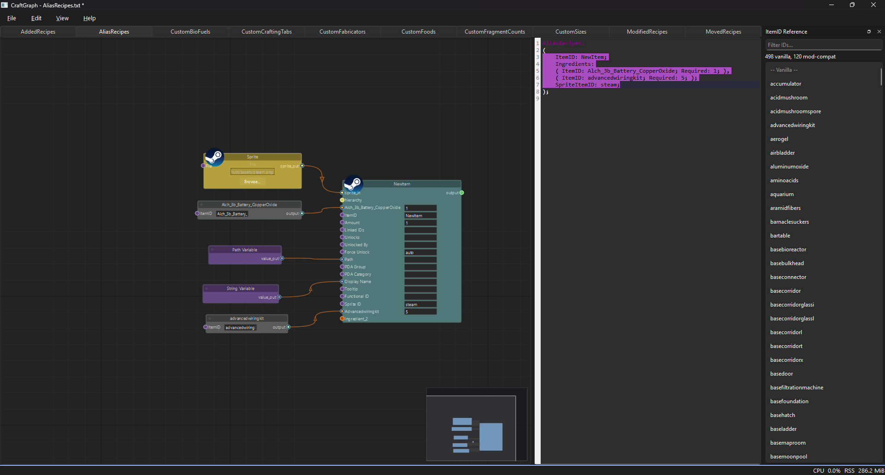
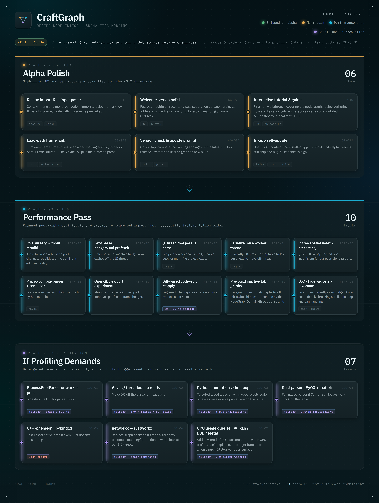

# CraftGraph

A node based recipe editor for [CustomCraft3](https://github.com/MrPurple6411/PrimeSonicSubnauticaMods/tree/master/CustomCraft3), the Subnautica modding framework.

Open a mod folder and every recipe becomes a node you can wire together. Ingredients are
connections, not text you retype in four places. The EasyMarkup source stays visible beside the
graph and edits flow both ways, so you can work in whichever view suits the change.

Circular dependencies are caught while you draw them, not after the game refuses to load.

<p align="center">
  <a href="craftgraph/data/assets/screenshot-node-editor.png">
    
  </a>
  <br>
  <sub><i>Node editor, live source view and ItemID reference, editing an AliasRecipes file</i></sub>
</p>

> **Status: 0.1.0-alpha.1.** Early and rough in places. No installer yet, so the source install
> below is the way in. Expect sharp edges; bug reports are welcome.

## What it does

- **Edit all 10 CC3 block types** as nodes: ModifiedRecipes, AddedRecipes, AliasRecipes,
  CustomFabricators, CustomCraftingTabs, CustomFoods, CustomBioFuels, CustomSizes,
  CustomFragmentCounts and MovedRecipes.
- **Wire ingredients by dragging** between nodes, and edit every field inline on the node.
- **Catch cycles live.** Offending edges turn red and a warning fires before a link that would
  close a loop is made.
- **Round-trip the source.** A syntax-highlighted EasyMarkup editor sits beside the graph; type in
  either and the other follows. Export writes valid `.txt` files back out.
- **Autocomplete item IDs** from the vanilla TechType list, the mod-compat list and every ID your
  own mod folder defines, in both the node fields and the code editor.
- **Find problems across the project.** `Edit > Find Issues` lists orphans, cycles and unresolved
  references, and clicking a row jumps to the node that owns it.
- **Follow the files.** A folder watcher reparses on external saves and node positions persist in
  `.craftgraph/layout.json` beside the mod.
- **Work from the terminal too.** The CLI checks cycles, renders an interactive HTML graph and
  watches a folder without opening the GUI at all.

## Roadmap

<p align="center">
  <sub>&darr; <i>Click to view full resolution</i> &darr;</sub>
  <br><br>
  <a href="craftgraph/data/assets/roadmap-vertical@4x.png">
    
  </a>
</p>

## Install

Requires [uv](https://docs.astral.sh/uv/). It fetches its own Python 3.14, so nothing else needs
installing first.

```bash
git clone https://github.com/Rovetown/CraftGraph
cd CraftGraph
uv sync
uv run craftgraph gui
```

`uv sync` installs the GUI. Two optional extras exist for the CLI:

```bash
uv sync --extra visualizer    # pyvis, needed by `view` and `watch`
uv sync --extra pretty        # rich, for colored console logs
```

A packaged Windows installer is planned but not yet built, so there is nothing on the releases
page to download for now.

## The GUI

```bash
uv run craftgraph gui                        # start at the welcome screen
uv run craftgraph gui ./my-mod/WorkingFiles/ # open a mod folder directly
```

Each `.txt` file in the folder opens as its own tab with its own graph. The right hand panel lists
every item ID the project can reference. Undo and redo cover every edit, graph or text.

## The CLI

### Check for circular dependencies

```bash
craftgraph check ./my-mod/WorkingFiles/
```

Reports every cycle it finds with the full path, or says there are none. Add `-v` for file, recipe
and node-type counts.

### Render an interactive graph

```bash
craftgraph view ./my-mod/WorkingFiles/
```

Writes `craftgraph.html` and opens it. `-o` sets a different path. The layout is hierarchical,
top down:

- **Green** nodes are raw materials, crafted from nothing
- **Blue** nodes are intermediates, crafted and then used as an ingredient
- **Gold** nodes are end products, crafted and used by nothing else
- **Red** edges are circular dependencies
- **Solid green** edges are `Unlocks`, **dashed orange** are `UnlockedBy`

Hover a node for its recipe type, source file, ingredients and dependents.

### Watch a folder

```bash
craftgraph watch ./my-mod/WorkingFiles/
```

Opens the graph, then rebuilds it within about a second of any `.txt` save. Refresh the tab to see
the new one. `Ctrl+C` stops.

### Export and file association

```bash
craftgraph export ./my-mod/WorkingFiles/ -o ./out/   # model back to EasyMarkup text
craftgraph register                                   # associate .craftgraph files (Windows)
craftgraph unregister
```

## Development

Commands go through [just](https://github.com/casey/just):

```bash
just --list      # every recipe
just sync        # install and sync dependencies
just test        # the fast suite, slow Qt files excluded
just test-all    # everything, 2096 tests
just qa          # lint, format check and typecheck
just build       # PyInstaller bundle
```

Ruff and mypy both run clean; `qt_gui`, `sync` and `qt_nodes` are exempt from strict typing for
now, which `pyproject.toml` records as debt rather than hiding.

### Tech stack

| Layer           | Choice                | Why                                                    |
|-----------------|-----------------------|--------------------------------------------------------|
| Language        | Python 3.14           | Strong ecosystem, good for both scripts and GUIs        |
| GUI             | PySide6 + NodeGraphQt | Mature Qt node graph, retained mode, native widgets     |
| Graph logic     | NetworkX              | Cycle detection, topological sort, everything else      |
| File watching   | Watchdog              | Cross-platform folder watcher                           |
| HTML output     | Pyvis                 | Interactive graph with no GUI dependency                |
| CLI             | Click                 | Subcommands without ceremony                            |
| Package manager | uv                    | Fast, lockfile based, no manual virtualenv              |
| Distribution    | PyInstaller           | One portable binary, no Python install on the far end   |

## License

MIT. See [LICENSE](LICENSE).

CustomCraft3 itself is by [MrPurple6411](https://github.com/MrPurple6411/PrimeSonicSubnauticaMods)
and is not affiliated with this project.
